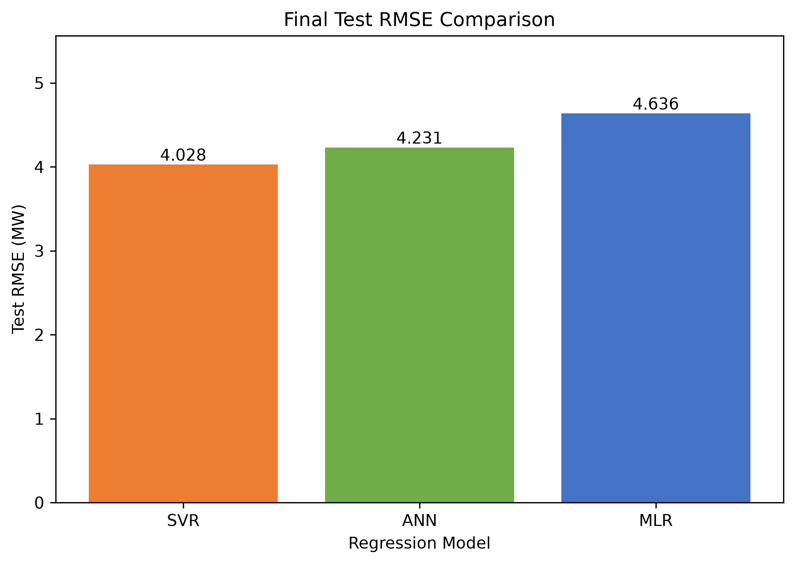
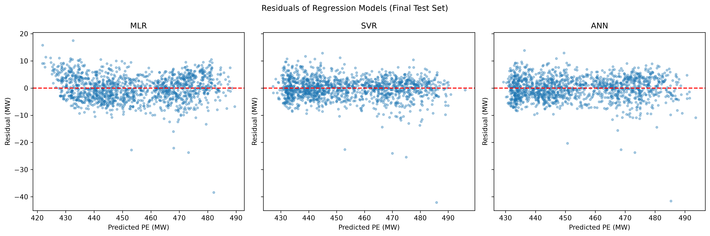
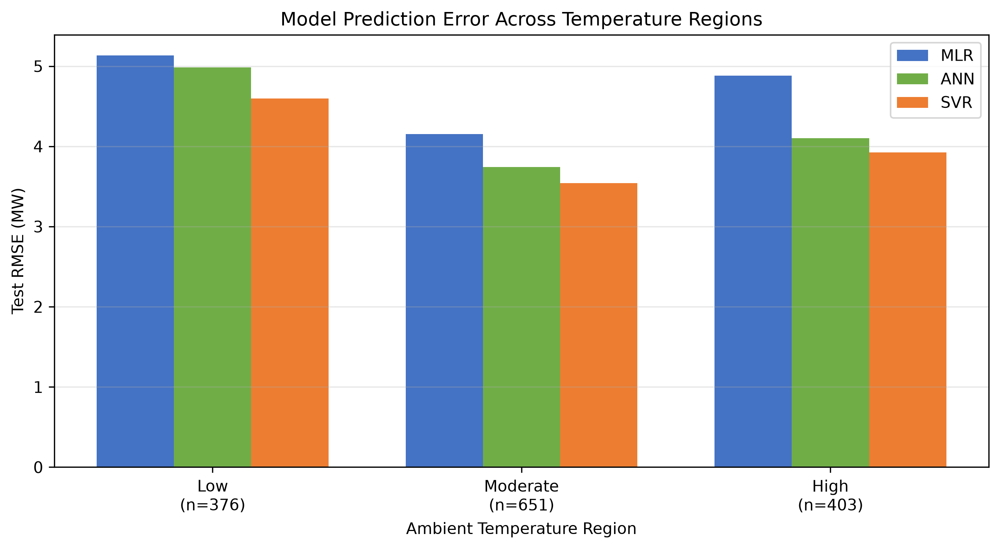
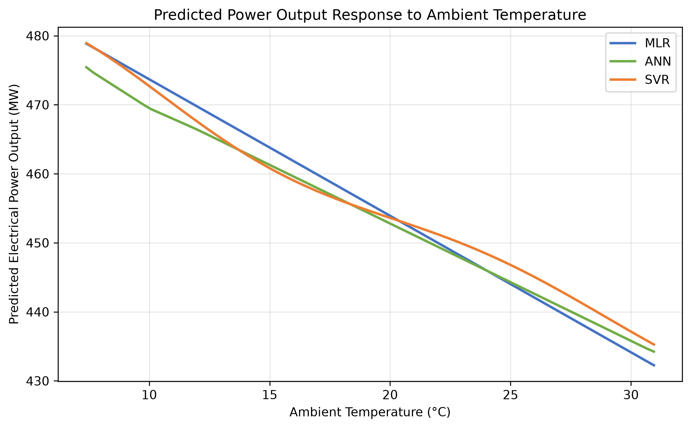

# Combined Cycle Power Plant Electrical Output Prediction

**MMA3001: Numerical Methods and Machine Learning | Monash University Malaysia**

## Project overview

This project predicts the net electrical power output of a combined cycle power plant (CCPP) from four measured operating variables. Three regression methods are implemented and compared:

- **Multiple Linear Regression (MLR):** an interpretable, computationally inexpensive baseline.
- **Support Vector Regression (SVR):** nonlinear regression using a radial basis function (RBF) kernel.
- **Artificial Neural Network (ANN):** a feedforward multilayer perceptron for nonlinear regression.

The project compares prediction accuracy, hyperparameter configurations, computational requirements and behaviour across ambient-temperature regions. Its intended application is *offline estimation and performance assessment* for operating conditions similar to those in the historical dataset. The code is a reproducible experiment, not a real-time power plant controller or a command-line service for predicting arbitrary new inputs.

## Dataset

The [Combined Cycle Power Plant dataset](https://archive.ics.uci.edu/dataset/294/combined%2Bcycle%2Bpower%2Bplant) from the UCI Machine Learning Repository contains 9,568 observations collected during full-load operation between 2006 and 2011. The five required columns are:

| Variable | Description | Unit | Recorded range | Role |
| --- | --- | --- | --- | --- |
| `AT` | Ambient temperature | °C | 1.81–37.11 | Input |
| `V` | Exhaust vacuum | cm Hg | 25.36–81.56 | Input |
| `AP` | Atmospheric pressure | mbar | 992.89–1033.30 | Input |
| `RH` | Relative humidity | % | 25.56–100.16 | Input |
| `PE` | Net electrical power output | MW | 420.26–495.76 | Prediction target |

The program loads the first sheet of `data/Folds5x2_pp.xlsx`, checks the required columns and numerical values, and removes 41 exact duplicate observations, leaving 9,527 unique rows. It rejects missing files, missing required columns, non-numeric entries and missing/non-finite values. It does **not** fully enforce physical operating limits or verify whether all combinations of otherwise valid inputs are represented in the training data.

### Dataset location

The file must be at the following path **relative to `main.py`**:

```text
data/Folds5x2_pp.xlsx
```

If the workbook is not included in your copy of the repository, download the `.xlsx` dataset from the [UCI source](https://archive.ics.uci.edu/dataset/294/combined%2Bcycle%2Bpower%2Bplant) and place `Folds5x2_pp.xlsx` inside the `data` folder. Keep its original column names (`AT`, `V`, `AP`, `RH`, `PE`).

## Quick start

From a fresh clone, create a Python virtual environment, install `requirements.txt`, confirm that the workbook is at `data/Folds5x2_pp.xlsx`, then run `python main.py`. The script performs the complete training and evaluation workflow and saves CSV results in `results/` and figures in `figures/`. Run `python -m pytest test_main.py -v` **after** `main.py` because some tests inspect generated results.

The code uses paths relative to `main.py`, so these commands should be run from the repository root. The project is a complete analysis script, **not** an interactive prediction application.

## Repository files

```text
MMA3001/
├── main.py                         # Runs the ten-stage analysis
├── main_model_functions.py         # Dataset, splitting, evaluation and model builders
├── test_main.py                    # 13 automated tests (pytest)
├── README.md                       # Project documentation and reproduction steps
├── requirements.txt                # Pinned dependencies for the tested environment
├── LICENSE                         # Source-code licence
├── .gitignore                      # Excludes virtual environments and cache files
├── test_report.txt                 # Saved pytest verification output
├── data/
│   └── Folds5x2_pp.xlsx            # Original UCI dataset (CC BY 4.0)
├── results/                         # Five CSV analysis outputs
│   ├── svr_tuning_results.csv
│   ├── ann_tuning_results.csv
│   ├── model_performance_results.csv
│   ├── computational_cost_analysis.csv
│   └── temperature_region_performance.csv
├── figures/                         # Seven PNG visualisations
│   ├── correlation_heatmap.png
│   ├── model_rmse_comparison.png
│   ├── model_actual_vs_predicted.png
│   ├── model_residual_plots.png
│   ├── accuracy_vs_computational_cost.png
│   ├── temperature_region_rmse.png
│   └── temperature_response_check.png
└── docs/                            # API references and main-script workflow documentation
    ├── index.html                   # pdoc module index
    ├── main_model_functions.html    # pdoc function reference
    ├── test_main.html               # pdoc test-function reference
    ├── main_workflow.html           # Separate guide to the sequential main script
    └── search.js                    # pdoc search index
```


The script writes CSV results into `results/` and PNG figures into `figures/`. The `docs/` folder contains pdoc-generated function references and a separate HTML guide to the executable workflow. Source files, input data, generated results and documentation are kept in separate directories.

## Getting the repository

Clone the repository using its HTTPS URL from GitHub (**Code → HTTPS**):

```bash
git clone https://github.com/MOHUSSAIN/MMA3001.git
cd MMA3001
```

Alternatively, download the repository ZIP from GitHub and extract it before running the installation commands. Work from the directory containing `main.py`.

## Environment and installation

The project was run using **Python 3.13.0** and the pinned packages in `requirements.txt`: NumPy, pandas, scikit-learn, Matplotlib, openpyxl, pytest and pdoc. A virtual environment is recommended to avoid conflicts with other projects. The dependency versions document the development environment; compatible installations on other systems may use different versions.

From a terminal opened in the repository's root directory:

**Windows PowerShell**

```powershell
py -m venv .venv
.\.venv\Scripts\Activate.ps1
python -m pip install -r requirements.txt
```

**macOS / Linux**

```bash
python3 -m venv .venv
source .venv/bin/activate
python -m pip install -r requirements.txt
```

If PowerShell blocks activation, the environment's Python executable can be used directly instead of changing the system execution policy. For example: `.\.venv\Scripts\python.exe -m pip install -r requirements.txt`.

## Running the project

From the repository root, with the virtual environment activated, run:

```bash
python main.py
```

`main.py` is a sequential script. It performs the entire workflow directly when executed; **there is no `main()` function or interactive menu**. It does not need additional command-line arguments. The dataset path and output paths are resolved relative to the script's location.

The script performs these stages:

1. Load and validate the dataset; remove exact duplicates.
2. Generate a correlation analysis and heatmap.
3. Split data into training (70%), validation (15%) and independent testing (15%) subsets using random state 42.
4. Fit the MLR baseline.
5. Evaluate 60 SVR hyperparameter configurations on validation data.
6. Evaluate 36 ANN hyperparameter configurations on validation data.
7. Select the model by validation RMSE, refit all three methods on the combined training and validation data, and evaluate them on the untouched test set.
8. Generate the final prediction and residual figures.
9. Estimate computational requirements and compare accuracy with training and prediction costs.
10. Evaluate errors across ambient-temperature regions and examine the predicted temperature response for physical plausibility.

Standardisation for SVR and ANN is fitted inside scikit-learn pipelines, using training data during tuning. The test set is kept separate from model selection. The script may take some time to finish because it trains all 60 SVR and 36 ANN configurations on each run.

## Expected results

The program uses a fixed random seed (`random_state=42`) for data splitting and ANN initialisation. With the supplied workbook and documented environment, the model-selection and error metrics below were obtained from the final experiment. Runtime values are **observations from one execution**, not machine-independent targets.

| Model | Validation RMSE (MW) | Test MAE (MW) | Test RMSE (MW) | Test R² |
| --- | ---: | ---: | ---: | ---: |
| MLR | 4.6154 | 3.6399 | 4.6365 | 0.9268 |
| ANN | 4.1159 | 3.2360 | 4.2013 | 0.9399 |
| **SVR** | **3.8950** | **2.8765** | **3.9500** | **0.9468** |

The selected configurations were:

- **SVR:** RBF kernel, `C=200`, `epsilon=1.5`, `gamma=0.5` (best of 60 combinations).
- **ANN:** hidden layers `(50, 25)`, `alpha=0.1`, initial learning rate `0.001` (best of 36 combinations).
- **MLR:** ordinary least-squares baseline without hyperparameter tuning.

Configurations were selected using **validation RMSE**. Each selected model was then refitted on the combined training and validation data (85% of the cleaned dataset), with final performance reported on the independent 15% test set. SVR achieved the lowest validation and test RMSE, while ANN was considerably faster at predicting the test batch in the reported run.

### Computational performance

Final **training times were measured once per fitted model**. Final prediction time was measured for the entire **1,430-observation test batch**, following one warm-up prediction, and reported as the **median of 20 repeated predictions**.

| Model | Final training time (s) | Median batch prediction time (s) | Approx. basic arithmetic operations / prediction |
| --- | ---: | ---: | ---: |
| MLR | 0.0044 | 0.001026 | 8 |
| ANN | 14.9763 | 0.000816 | 2,950 |
| SVR | 9.5861 | 0.851972 | 72,898 |

These timings are from the most recent supplied execution. The measured SVR/ANN prediction-time ratio for this run was **1,044.3×**, but inference times varied significantly between runs even after taking medians. This ratio must not be interpreted as a hardware-independent benchmark. The ANN contained **1,551 trainable parameters** (1,475 weights and 76 biases); the final SVR used **5,207 support vectors**. The arithmetic-operation estimates exclude feature scaling, nonlinear activation costs, RBF exponential calculations and other implementation overheads.

### Engineering checks

SVR obtained the lowest test RMSE in each ambient-temperature region: **4.5984 MW** (low), **3.5396 MW** (moderate), and **3.9238 MW** (high). All three models predicted a decrease in electrical output across the sampled ambient-temperature sweep with other inputs fixed at their training-set median values. One SVR test prediction (0.07%) was outside the development dataset's observed PE range (420.26–495.76 MW); MLR and ANN had none. These checks help identify model behaviour but do not prove physical validity or reliable extrapolation to unobserved conditions.

## Generated outputs

Running `main.py` creates or overwrites the following generated files (within `results/` and `figures/`):

**CSV results**

| File | Contents |
| --- | --- |
| `results/svr_tuning_results.csv` | Validation metrics, support-vector counts and timings for 60 SVR configurations |
| `results/ann_tuning_results.csv` | Training/validation metrics, iterations and timings for 36 ANN configurations |
| `results/model_performance_results.csv` | Independent test metrics and final-model timings |
| `results/computational_cost_analysis.csv` | Test accuracy, prediction time and approximate arithmetic-operation estimates |
| `results/temperature_region_performance.csv` | Sample counts and test MAE/RMSE for low, moderate and high ambient-temperature regions |

**PNG figures**

| File | Contents |
| --- | --- |
| `figures/correlation_heatmap.png` | Dataset correlations |
| `figures/model_rmse_comparison.png` | Final test RMSE by model |
| `figures/model_actual_vs_predicted.png` | Predicted versus measured PE |
| `figures/model_residual_plots.png` | Final test residuals |
| `figures/accuracy_vs_computational_cost.png` | Accuracy versus prediction-time comparison |
| `figures/temperature_region_rmse.png` | Test RMSE across ambient-temperature regions |
| `figures/temperature_response_check.png` | Predicted PE response as ambient temperature increases with other inputs fixed |

Existing CSV/PNG files with these names are overwritten when the analysis is run again. Model errors should remain consistent for the same dataset and environment, but runtime measurements can vary.

### Preview of the generated figures

These are selected figure previews. All seven PNG files are available in `figures/`; they are generated by the project rather than downloaded images.

When the generated PNGs are included in the repository, GitHub displays these figures directly:

**Final test comparison**



**Prediction residuals**



**Operating-region accuracy**



**Physical plausibility check**



The image previews work once the PNGs have been generated inside `figures/` and committed to the repository. The complete list of all seven figures appears above.

## Automated testing

The 13 tests in `test_main.py` check input structure, duplicate removal, deterministic data splitting, metric calculations, SVR/ANN pipeline settings, invalid-input handling, final result integrity and the SVR-versus-MLR baseline comparison. The additional workflow-output test checks that `main.py` compiles and that the expected **five CSV files** and **seven PNG files** exist. It also checks the row counts of the tuning CSVs (60 SVR and 36 ANN configurations).

Run the full script before running pytest on a fresh clone, as several tests inspect artifacts produced by a prior execution:

```bash
python main.py
python -m pytest test_main.py -v
```

**Windows PowerShell:** show the test output in the terminal and write it to `test_report.txt` at the same time:

```powershell
python -m pytest test_main.py -v 2>&1 | Tee-Object -FilePath test_report.txt
```

The workflow-output test verifies saved files from a previous run; it **does not execute** the computationally expensive hyperparameter search within pytest. A passing test suite does not independently establish accuracy on new plants or guarantee safe physical behaviour. The test report should be regenerated after the final code changes; don't report **13 passed** until pytest actually confirms it.

### How to verify the reproduced results

On a fresh clone, confirm that `main.py` completes its ten stages and saves five CSV files in `results/` and seven PNGs in `figures/`. Compare the test error metrics with the table above, then run pytest and inspect the test report. A fixed random seed makes the data partition and ANN configuration repeatable; execution times can change substantially with hardware and workload.

## Source-code documentation

The project includes documentation for both reusable functions and the sequential main script:

- [`docs/main_model_functions.html`](docs/main_model_functions.html): pdoc-generated API reference for the five user-written helper functions.
- [`docs/test_main.html`](docs/test_main.html): pdoc-generated reference explaining the automated test functions.
- [`docs/main_workflow.html`](docs/main_workflow.html): higher-level description of the executable analysis, including how it is run, model selection, outputs, engineering checks and limitations.
- [`docs/index.html`](docs/index.html): index of the pdoc-generated modules.

To regenerate API documentation after updating Python docstrings, run from the repository root:

```bash
python -m pdoc main_model_functions test_main -o docs
```

`main.py` executes its complete analysis at the top level, rather than defining an importable `main()` function. It should be run with `python main.py`, **not imported by pdoc**. The separate `main_workflow.html` page documents its flow without triggering a model run. The `docs/` directory is included in the repository so the pages can be opened without regenerating them.

## Software environment

Python 3 and the packages listed in `requirements.txt` are needed to reproduce the workflow. The core packages are NumPy, pandas, scikit-learn, Matplotlib and openpyxl; pytest is used for testing. pdoc generates the API documentation. The pinned versions in `requirements.txt` record the working development environment.

To inspect the Python version and installed dependency versions:

```bash
python --version
python -m pip show numpy pandas scikit-learn matplotlib openpyxl pytest
```

The project was developed in VS Code on Windows; the code uses script-relative data and output paths to avoid dependence on a particular user's computer. Exact training and prediction times may change with the operating system, hardware and installed library versions.

## Troubleshooting

- **`FileNotFoundError` for `Folds5x2_pp.xlsx`:** verify the original file is at `data/Folds5x2_pp.xlsx` and is named exactly as shown.
- **`ModuleNotFoundError`:** activate the intended virtual environment and install `requirements.txt` using the same Python interpreter that runs `main.py`.
- **Tests cannot find a generated CSV:** run `main.py` first and check that the CSVs are under `results/`; tests need to reference the same directory.
- **README image previews are missing:** ensure the PNGs are committed under `figures/` with the exact referenced filenames.
- **Runtime values differ:** timing depends on machine load, hardware and installed libraries. Compare prediction-error metrics separately from measured timings.

## Scope and limitations

- The models were developed using one historical CCPP dataset representing **full-load** operation. Generalisation to other plants, later years and part-load operation has not been demonstrated.
- Validation uses a single reproducible random split; cross-validation or chronological evaluation would provide additional evidence of generalisation.
- Inputs beyond the historical operating domain, or unusual combinations of otherwise valid inputs, may lead to unreliable extrapolation.
- Regional analysis showed larger errors at low ambient temperatures. The models should not be treated as thermodynamic simulators or used for safety-critical control without further independent validation.
- Arithmetic-operation estimates omit some nonlinear and preprocessing costs. Prediction timings are medians of 20 repeated test-batch predictions; training times use one measurement per final model. Both remain system-dependent.

## Design and validation decisions

The three methods were chosen to compare an interpretable linear baseline (MLR) against two credible nonlinear alternatives (RBF SVR and feedforward ANN). Hyperparameter selection uses validation RMSE rather than test metrics. Model performance is evaluated using MAE, RMSE, R², residual plots and additional analyses of temperature-region error and temperature-response plausibility. The preferred model for the current *accuracy-first, non-time-critical offline* use is SVR; ANN remains a credible choice if prediction speed matters more. None of these checks establishes reliable behaviour outside the historical plant/domain.

## Dataset attribution and licensing

**Dataset:** Tfekci, P., & Kaya, H. (2014). *Combined Cycle Power Plant* [Data set]. UCI Machine Learning Repository. https://doi.org/10.24432/C5002N

The source dataset is distributed under the **Creative Commons Attribution 4.0 International (CC BY 4.0)** licence: https://creativecommons.org/licenses/by/4.0/. The original workbook is used as the source; the program removes duplicate rows in memory for analysis. Dataset licensing is separate from the source-code licence in `LICENSE`.

**Related study:** Tüfekci, P. (2014). Prediction of full load electrical power output of a base load operated combined cycle power plant using machine learning methods. *International Journal of Electrical Power & Energy Systems, 60*, 126–140. https://doi.org/10.1016/j.ijepes.2014.02.027

## References

- Tüfekci, P. (2014). Prediction of full load electrical power output of a base load operated combined cycle power plant using machine learning methods. *International Journal of Electrical Power & Energy Systems, 60*, 126–140. https://doi.org/10.1016/j.ijepes.2014.02.027
- Pedregosa, F., et al. (2011). Scikit-learn: Machine learning in Python. *Journal of Machine Learning Research, 12*, 2825–2830. https://jmlr.org/papers/v12/pedregosa11a.html
- Tfekci, P., & Kaya, H. (2014). *Combined Cycle Power Plant* [Data set]. UCI Machine Learning Repository. https://doi.org/10.24432/C5002N

## AI assistance

ChatGPT was used to assist with Python development, debugging, automated testing, understanding implementation concepts, supplementary analyses and drafting/revising parts of the project documentation. Suggestions and generated code were reviewed and adapted, and the tested functionality was checked using program execution and pytest. See the accompanying project report for the full AI-use reflection.

## Project report

The accompanying MMA3001 project report contains the full methodology, validation, model-selection justification, computational analysis, engineering interpretation, limitations and AI-use reflection.